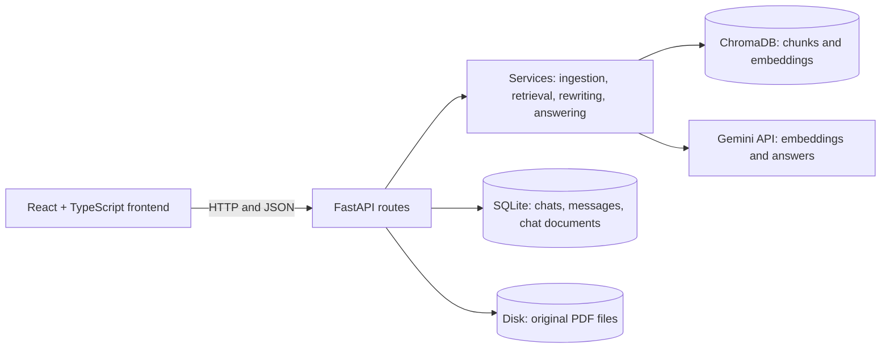
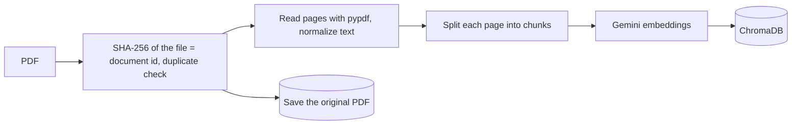
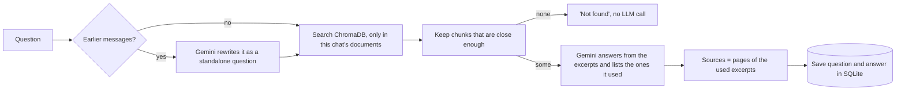

# AI Researcher

[](https://github.com/Hadishof/Ai-researcher/actions/workflows/ci.yml?query=branch%3Amain)
[](LICENSE)

      

Ask questions about your PDF documents in Hebrew or English, and get answers with page citations that open the source PDF at the cited page.

**At a glance:** Bilingual RAG (Hebrew/English) · FastAPI + React/TypeScript · 97% retrieval Hit@1 on the dev set · 218 automated tests in CI

<!-- demo.gif and screenshots go here -->

## Features

- **Bilingual RAG over PDFs.** Upload PDFs in Hebrew or English and ask in either language; the answer comes in the language of the question, also when the source is in the other language. Hebrew is displayed right-to-left.
- **Per-chat document scoping.** Each chat selects its own documents from a shared library, and the search only looks at those, so information from unrelated files never mixes in.
- **Follow-up questions.** A question like "and with 8 years of seniority?" is rewritten into a standalone question, using the recent messages, before searching.
- **Conflict reporting.** When the selected documents disagree (for example two different prices), the answer says so and states what each document says, instead of picking one.
- **Clickable page citations.** Every answer lists the pages it is based on; clicking one opens the original PDF at that page in a new tab.
- **Honest "not found".** If nothing relevant is found, the app says so instead of guessing.
- **Saved conversations.** Chats are stored, can be renamed, reopened and continued later.
- **Interface.** Light and dark mode (follows the system, can be switched), and a sidebar that can be resized and collapsed, with the layout remembered.

## Architecture



**Uploading a document**



**Asking a question**



The backend is split into layers, so each file has one job:

| Layer | Folder | Responsibility |
|---|---|---|
| Routes | `backend/app/api/routes/` | HTTP only: validate input, call services, return status codes |
| Services | `backend/app/services/` | The logic: ingestion, chunking, retrieval, rewriting, answering |
| Storage | `backend/app/db/` | The only code that touches ChromaDB, SQLite and the PDF files |
| Schemas | `backend/app/schemas/` | Pydantic models for every request and response |
| Core | `backend/app/core/` | Settings and the shared Gemini client |

## Tech stack

| Area | Tools |
|---|---|
| Backend | Python 3.12, FastAPI, Pydantic, pydantic-settings, Uvicorn |
| AI | Google Gemini through the `google-genai` SDK: `gemini-embedding-001` for embeddings, `gemini-2.5-flash` for answers |
| Storage | ChromaDB (vectors, cosine distance), SQLite (conversations), local disk (PDF files) |
| PDF | pypdf |
| Frontend | React 19, TypeScript, Vite, lucide-react icons, IBM Plex fonts |
| Testing | pytest (Gemini replaced by a fake), Vitest and React Testing Library |
| CI | GitHub Actions: backend, evaluation and frontend tests, plus the frontend build |

## Evaluation

The goal was to measure the system instead of guessing. The evaluation code is in [`eval/`](eval/), and every number below comes from the reports in [`eval/results/`](eval/results/).

### Method

- **Dataset:** 59 questions with manually verified answers (41 English, 18 Hebrew) about 5 synthetic PDFs (3 English, 2 Hebrew, 39 pages), committed so anyone can reproduce the runs. Each question lists the pages and facts its answer must contain.
- **Question types:** factual (30), distractor (11: the documents also contain a similar but different fact, such as the same detail for another product model, to test that the right one is chosen), not found (7), cross-lingual (6: a question in one language about a document in the other), conflict (3: two documents disagree), follow-up (2).
- **Dev/test split:** a stratified split by type and language with a fixed random seed: 40 dev questions, 19 test questions ([`split.json`](eval/data/split.json)). All tuning used only the dev set; **the test set was never used for tuning.**
- **Selection rules fixed before the runs:** chunk size = highest MRR; distance threshold = most correct pages kept plus "not found" questions blocked; margin = the smallest that loses no correct page.
- **Deterministic checks only:** page matching and expected-fact matching (case-insensitive, ignoring thousands separators). No LLM judge.

**Hit@k** is the share of questions whose correct page is among the top k results. **MRR** (mean reciprocal rank) also rewards ranking it higher: 1 if it is first, 1/2 if second, and so on.

### Retrieval results (dev set, 35 answerable questions)

Chunk sizes, with our chunker and with LangChain's `RecursiveCharacterTextSplitter` (same size and overlap, LangChain used only in the evaluation):

| Setup | Chunks | Hit@1 | Hit@3 | Hit@5 | MRR |
|---|---|---|---|---|---|
| **Ours, 500 characters** | 92 | **97%** | **100%** | **100%** | **0.981** |
| LangChain, 500 | 90 | 94% | 100% | 100% | 0.962 |
| Ours, 1000 | 49 | 91% | 94% | 97% | 0.938 |
| LangChain, 1000 | 49 | 94% | 94% | 97% | 0.952 |
| Ours, 1500 | 39 | 94% | 94% | 97% | 0.953 |
| LangChain, 1500 | 39 | 94% | 94% | 97% | 0.952 |

With the chosen settings (chunk size 500, distance threshold 0.34, relative margin 0.10), the correct page reaches the LLM for all 35 answerable dev questions, and both pages of both dev conflict questions do too. English questions ranked the correct page first every time; Hebrew questions 9 out of 10 times, and always within the top 5.

### What the evaluation found and fixed

The first run showed our chunker losing to LangChain at size 500. Looking at the chunks of the missed pages revealed two problems in the app itself:

1. **PDF ligatures.** The PDF text contained single characters such as "fi" in place of "fi", so "filter" did not match "filter". The text is now Unicode-normalized (NFKC).
2. **Chunking.** The extracted text had no blank lines, so the "paragraphs first" rule never applied, and headings and table rows without full stops were glued together. The chunker now keeps whole lines (paragraph, then line, then sentence, then a cut).

After the fixes, our chunker at size 500 went from Hit@1 86% to 97% and MRR from 0.907 to 0.981 (reports [before](eval/results/2026-11-19_223431_retrieval.md) and [after](eval/results/2026-11-19_225052_retrieval.md)).

### Findings and limitations of the evaluation

- **A distance threshold cannot recognize "not found" questions.** The not-found questions are about the documents' own topics (for example a product the manual does not list), so their closest chunks are as close as real answers. At any threshold that keeps every correct page, only 1 of the 5 dev not-found questions is blocked; blocking 2 would lose 5 correct pages. The real protection is the instruction to answer only from the excerpts and to say "not found" otherwise.
- **The threshold is fragile.** 0.34 instead of 0.38 was decided by a single dev question.
- **The dev set is small.** With 35 answerable questions, one question moves a percentage by about 3 points, so small differences between setups are not meaningful.

### Answer-level results on the held-out test set

**In progress.** The full run with answers on the 19 test questions is not finished yet (the free tier limits how many answers can be generated per day). Results will be added here when it completes.

## Key design decisions

- **No LangChain in the backend.** Direct calls to ChromaDB, Gemini and pypdf mean fewer layers to understand and debug; LangChain is used only in the evaluation, as a baseline.
- **SHA-256 of the file as the document id.** The same file always gets the same id, so duplicates are caught without extra bookkeeping, and the id (64 hex characters) is safe to build a file path from; the uploaded filename never is.
- **SQLite for chats, ChromaDB for vectors.** Conversations need relations and cascading deletes; similarity search needs a vector index. Each store does the job it is built for.
- **A junction table for per-chat documents.** `conversation_documents` links chats and documents many-to-many, so the library is shared while each chat searches only its own selection (a ChromaDB metadata filter).
- **Structured output for the used excerpts.** Gemini returns JSON with the answer and the numbers of the excerpts it used, so the sources list only pages that support the answer, not everything that was retrieved.
- **Messages are saved only after Gemini succeeds.** A failed request leaves no half-saved exchange; the user can simply ask again.
- **No LLM call when nothing is relevant.** If no chunk passes the distance filters, the app answers "not found" directly, which is faster and saves quota.

## API

Interactive documentation is available at `http://localhost:8000/docs` while the backend runs.

| Method | Path | Description |
|---|---|---|
| GET | `/health` | Health check |
| POST | `/documents` | Upload a PDF (409 with the existing document if it was already uploaded) |
| GET | `/documents` | List documents, with how many chats use each |
| GET | `/documents/{id}/file` | The original PDF, shown in the browser |
| DELETE | `/documents/{id}` | Delete a document, its file, and its links to chats |
| POST | `/conversations` | Create a chat with its first documents |
| GET | `/conversations` | List chats |
| GET | `/conversations/{id}` | A chat with its messages and documents |
| PATCH | `/conversations/{id}` | Rename a chat |
| PUT | `/conversations/{id}/documents` | Replace a chat's documents |
| DELETE | `/conversations/{id}` | Delete a chat and its messages |
| DELETE | `/conversations` | Delete all chats |
| POST | `/chat` | Ask a question in a chat; returns the answer and its sources |

## Run it locally

**Prerequisites:** Python 3.12, Node.js 20.19+ or 22.12+, and a Gemini API key (free from [Google AI Studio](https://aistudio.google.com/apikey)).

**Backend** (from the repository root):

```bash
python -m venv .venv
source .venv/bin/activate          # Windows: .venv\Scripts\activate
cd backend
pip install -r requirements.txt
cp .env.example .env               # Windows: copy .env.example .env
# edit .env and set GOOGLE_API_KEY
uvicorn app.main:app --reload
```

The API runs at `http://localhost:8000`. Every other setting has a default; [`backend/.env.example`](backend/.env.example) lists them all.

**Frontend** (in a second terminal):

```bash
cd frontend
npm ci
npm run dev
```

Open `http://localhost:5173`.

**Free-tier limits.** Each question uses one embedding request (for the search) and one answer request; a follow-up uses one more to rewrite it. Each upload uses one embedding request per 100 chunks. The free tier has per-minute and per-day limits; during development the daily limit for `gemini-2.5-flash` was 20 requests. When a limit is reached, the app shows a rate-limit message and nothing is saved.

## Tests

None of the tests need an API key or internet access: Gemini is replaced by a fake, and every test uses its own temporary database.

From the repository root, with the virtual environment active:

```bash
# Backend: 128 tests
cd backend && pip install -r requirements-dev.txt && pytest && cd ..

# Evaluation code: 57 tests (metrics, dataset, split, caching)
cd eval && pip install -r requirements-eval.txt && pytest && cd ..

# Frontend: 33 tests, then the production build
cd frontend && npm test && npm run build && cd ..
```

GitHub Actions runs all three on every push and pull request ([`ci.yml`](.github/workflows/ci.yml)).

To run the evaluation itself (it calls Gemini, with caching and a `--dry-run` that prints the number of calls first), see [`docs/ROADMAP.md`](docs/ROADMAP.md#how-to-run-the-evaluation).

## Project structure

```
.
├── backend/
│   ├── app/                FastAPI app: api/routes, services, db, schemas, core
│   ├── tests/              pytest suite
│   └── requirements.txt
├── frontend/
│   ├── src/                components, API client, hooks, styles, tests
│   └── package.json
├── eval/
│   ├── data/               5 synthetic PDFs, 59 questions, the dev/test split
│   ├── results/            experiment reports (JSON and markdown)
│   └── run_eval.py         command-line entry point
├── docs/ROADMAP.md         build plan and progress, phase by phase
├── .github/workflows/      CI
└── LICENSE
```

## Limitations and next steps

- **Safari** ignores `#page=N`, so a citation opens the PDF at page 1 there (Chrome, Edge and Firefox open the cited page).
- **Free-tier limits** cap how many questions can be asked per day; the rate-limit message suggests waiting a minute even when the daily limit is the cause.
- **No authentication:** the app is single-user and meant to run locally; all chats and documents are shared.
- **Scanned PDFs** without a text layer are rejected; there is no OCR.
- **Small evaluation set:** 59 questions are enough to compare settings and find bugs, not to give precise accuracy figures.
- **Next steps:** finish the test-set answer run, add an LLM judge to check that answers add no claims beyond the excerpts, Docker setup, and deployment.

## License

[MIT](LICENSE)
